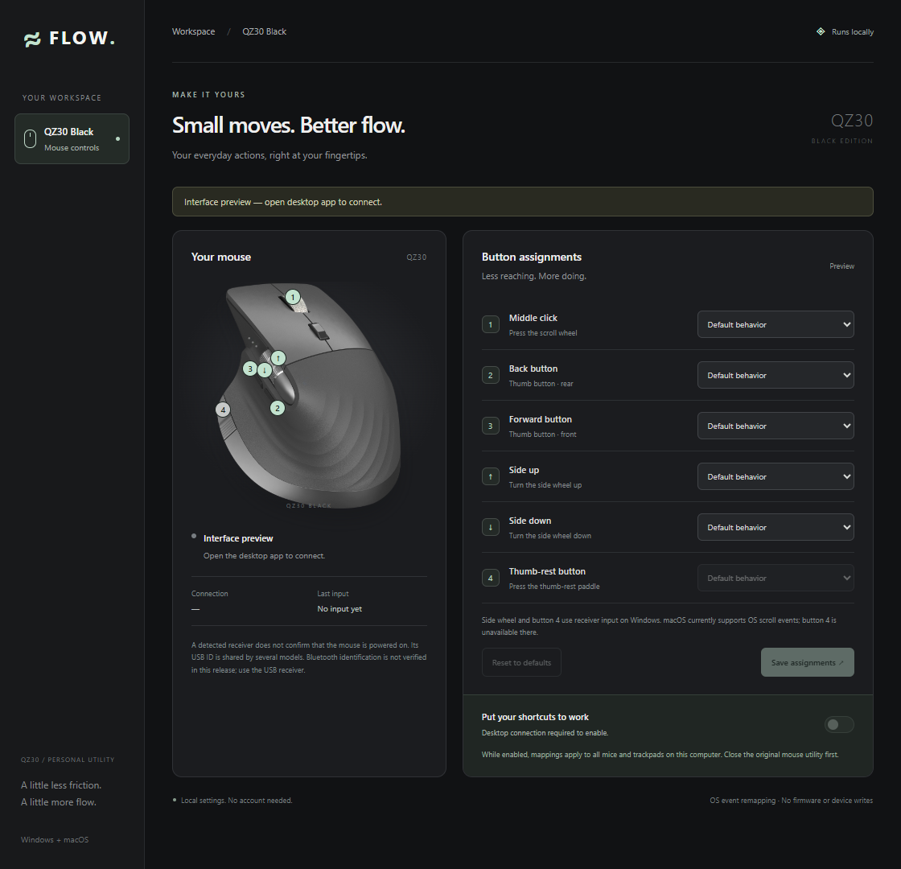

# QZ Flow

An independent desktop utility for a **Rexus Flow QZ30 Black**, with a shared Windows/macOS/Linux interface. It remaps OS mouse events and listens to observed side-wheel receiver reports on Windows; on Linux it reads the receiver's evdev input device; it does not use Rexus's DLL or change the mouse firmware.



## Use on Windows

Open `dist/windows/QZ Flow.exe` after building or extracting the Windows artifact.

1. Connect the mouse's USB receiver. Bluetooth identification is not verified.
2. Quit the original Mouse Assistant from its system tray menu. QZ Flow refuses to activate mappings while that utility is running.
3. Choose an action for Middle click (1), Back (2), Forward (3), Side up/down, or thumb-rest (4), then **Save and apply**. Button 4 currently requires Windows and the USB receiver.
4. Test a simple action, such as Back ? Copy, in a disposable text document. You can edit while mappings run; changes take effect only after Save.
5. Use the tray menu to **Pause/Resume mappings** or **Quit**. Close hides the window; Minimize keeps the normal Windows behavior. Open **Settings** in the sidebar for **Launch at login** and window-behavior details. Login launches start hidden.

Saved assignments restore automatically after prerequisite checks. Receiver loss suspends mappings, and reconnection can restore them (checked every two seconds). Explicit Pause persists across restarts and reconnections; Save and apply resumes mappings. Default-only assignments require no receiver.

Active mappings apply to **all mice and trackpads on this computer**, not exclusively the QZ30. A receiver being present does not prove that the mouse is powered on, and its USB ID is shared by several OEM models.

Actions are grouped into Mouse, Editing, Desktop and windows, Browser and tabs, Media, Zoom and capture, and Custom. Click a mouse marker to select its editor. Custom shortcuts can be selected manually or recorded while QZ Flow has focus; application assignments use a native picker. Save and apply activates the draft. See [action behavior and verification](docs/ACTIONS.md).

Primary left/right click and vertical scrolling are left alone. Windows accepts observed side-wheel and thumb-rest frames from this receiver; macOS requires horizontal OS scroll events and has no thumb-rest support. Disable is unavailable for Windows raw receiver wheel/thumb inputs because their native behavior cannot reliably be suppressed. Remapped shortcuts are one-shot actions, not held keys or drag controls. Physically held keyboard modifiers bypass synthetic shortcuts to avoid releasing keys you are holding.

## Use on Linux

Linux reads the receiver's `/dev/input/event*` device and re-emits all unmapped events through a `uinput` virtual mouse, so it works on X11 and Wayland. Both need permissions that ordinary users do not have by default:

1. Install the udev rule, then replug the receiver:

   ```sh
   sudo cp packaging/linux/70-qz-flow.rules /etc/udev/rules.d/
   sudo udevadm control --reload && sudo udevadm trigger
   echo uinput | sudo tee /etc/modules-load.d/uinput.conf && sudo modprobe uinput
   ```

   Sign out and in if `/dev/uinput` is still not writable. QZ Flow shows **Open input permissions** until the receiver's node is readable and `/dev/uinput` is writable; that button only explains these steps because Linux has no permission dialog.
2. Mappings grab only the QZ30 receiver's pointer device, not every mouse. Keyboard shortcuts and media keys are sent through a virtual keyboard. Unsupported actions (Show desktop, Minimize, Maximize) are rejected when saving; see [action behavior](docs/ACTIONS.md).
3. Button 4 (thumb rest), shortcut recording and window actions are unavailable. Choose keys manually for custom shortcuts. **Choose application** needs `zenity` or `kdialog`.
4. The tray icon needs an AppIndicator-capable desktop (GNOME needs the AppIndicator extension). Without a tray, start QZ Flow again to reopen its window. Launch at login writes `~/.config/autostart/dev.qzflow.desktop`.

Linux builds and unit tests run in GitHub Actions; real receiver behavior on Linux is unverified. Linux cannot see physically held keyboard modifiers, so a held Ctrl/Alt/Shift/Super combines with an injected shortcut instead of bypassing it, and on X11 the injected Ctrl/Alt/Shift/Super release can release a modifier you are physically holding. Only key and relative-motion events are mirrored by the virtual mouse; absolute-axis, LED and switch events on the grabbed receiver node are not. Programs started from an AppImage build do not inherit the AppImage's library environment.

## Build and run

Install Node.js 24, Rust stable, and the native [Tauri prerequisites](https://v2.tauri.app/start/prerequisites/) for the build computer. Windows requires the Microsoft C++ build tools and WebView2. macOS requires Xcode Command Line Tools. Linux requires `build-essential pkg-config libssl-dev libxdo-dev libwebkit2gtk-4.1-dev libayatana-appindicator3-dev librsvg2-dev` (Debian/Ubuntu package names).

```sh
npm ci
npm run dev
```

```sh
npm test
npm run check
npm run build -- --no-bundle
```

The last command produces a native release executable in `src-tauri/target/release`. For a Windows installer run `npm run build -- --bundles nsis`. For a macOS application run `npm run build -- --bundles app` **on a Mac**. For Linux packages run `npm run build -- --bundles appimage,deb` on Linux. Windows Authenticode and Apple signing/notarization are not configured. Updater artifact signing and draft releases are configured; in-app update prompts are a later milestone.

### macOS

The source contains an IOKit inventory and CoreGraphics event tap. Windows and macOS builds/tests run in GitHub Actions; the Milestone 1 Mac build passed. Physical Mac input and lifecycle behavior still require testing on a Mac.
After building on the Mac, place `QZ Flow.app` in a stable location such as Applications. Enable it in **System Settings → Privacy & Security → Accessibility** and **Input Monitoring**, then Save and apply again. Permission checks do not open background prompts. Quit the original Mouse Setting utility. Changing the application binary/location may require granting access again. Show Desktop uses F11 and follows your Mission Control keyboard settings. Keyboard layouts, natural scrolling, vendor button numbering, and remapping still need real Mac testing.

### Read-only diagnostic commands

From the project folder on Windows:

```powershell
src-tauri/target/debug/qz-flow.exe --diagnose
src-tauri/target/debug/qz-flow.exe --check-hook
src-tauri/target/debug/qz-flow.exe --trace-buttons
```

The first enumerates compatible receiver interfaces. The second also creates and tears down a disabled input hook. The third observes receiver mouse buttons, consumer controls and vendor HID input for 45 seconds; it excludes keyboard input and pointer coordinates. These checks send no HID reports or remapped shortcuts. Run diagnostic commands with a debug build to see console output.

## Settings and implementation

Assignments are stored in Tauri's per-user configuration directory under `dev.qzflow.desktop/mappings.json`. Windows normally uses `%APPDATA%`; macOS uses `~/Library/Application Support`; Linux uses `~/.config`. Saves use a staged file and atomic rename. The version 2 envelope stores assignments and an explicit Pause preference. Legacy and version 1 assignments load unchanged. Before replacing a legacy, corrupt, or unsupported file, an exact sibling `.mappings.json-*.backup` is retained; failed backup or replacement leaves the original file intact.

For recovery or downgrade, Quit QZ Flow, copy the current file somewhere safe, then copy the chosen backup to `mappings.json`. Legacy backups work with the older app. A malformed file is reported and defaults remain inactive until replaced through a successful Save.

- `ui/`: plain HTML, CSS, and JavaScript; no frontend framework or external assets.
- `src-tauri/src/engine.rs`: shared mapping and press/release state.
- `src-tauri/src/platform/`: Win32, macOS and Linux (evdev/uinput) inventory/hooks.
- `packaging/linux/`: udev rule granting the receiver and `/dev/uinput` access.
- `tests/ui.test.cjs`: interface state/race tests using mocked native calls.
- `analysis/ASSESSMENT.md`: REA findings from the supplied vendor packages.
- `docs/VALIDATION.md`: actual checks and unresolved hardware work.

The app does not install drivers, write DPI/EEPROM/firmware settings, or collect keyboard text. Launch at login is optional. It requires an open app session. It is not affiliated with or endorsed by Rexus. Vendor binaries are not bundled. At the user's request, the mouse image is copied unchanged from the original app; its source and ownership are documented in `ui/assets/NOTICE.md`.
