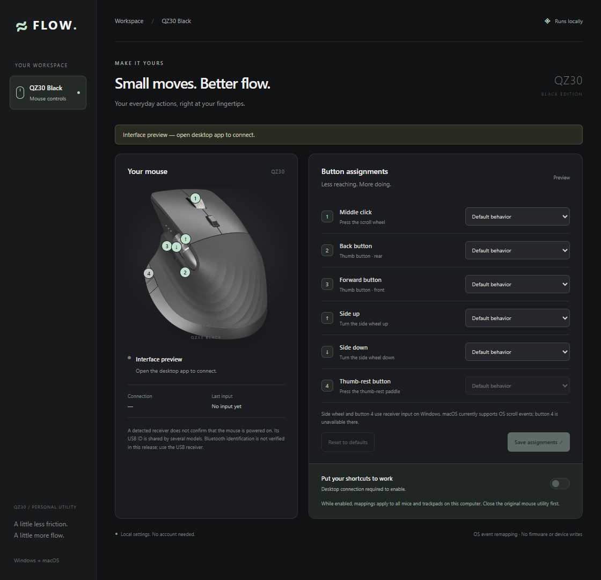

# QZ Flow

An independent desktop utility for a **Rexus Flow QZ30 Black**, with a shared Windows/macOS interface. It remaps OS mouse events and listens to observed side-wheel receiver reports on Windows; it does not use Rexus's DLL or change the mouse firmware.



## Use on Windows

Open `dist/windows/QZ Flow.exe` after building or extracting the Windows artifact.

1. Connect the mouse's USB receiver. Bluetooth identification is not supported in this first version.
2. Quit the original Mouse Assistant from its system tray menu. QZ Flow refuses to enable while that utility is running.
3. Choose an action for Middle click (1), Back (2), Forward (3), Side up/down, or thumb-rest (4), then **Save assignments**. Button 4 currently requires Windows and the USB receiver.
4. Turn on **Enable mouse mappings**. Test a simple action, such as Back → Copy, in a disposable text document.
5. Switch off to edit assignments. Closing QZ Flow stops its listener; the app always starts disabled.

While enabled, mappings apply to **all mice and trackpads on this computer**, not exclusively the QZ30. Remapping is automatically disabled when its compatible receiver is no longer found (checked every two seconds). A receiver being present does not prove that the mouse is powered on, and its USB ID is shared by several OEM models.

Actions: default behavior, copy, paste, undo, redo, select all, show desktop, Task View / Mission Control, volume up/down, browser back and forward. Primary left/right click and vertical scrolling are left alone. Windows accepts observed side-wheel and thumb-rest frames from this receiver; macOS currently requires horizontal OS scroll events and has no thumb-rest support. Remapped buttons behave as one-shot shortcuts, not held keys or drag controls. Holding a keyboard modifier bypasses the mapping to avoid releasing keys you are holding.

## Build and run

Install Node.js 24, Rust stable, and the native [Tauri prerequisites](https://v2.tauri.app/start/prerequisites/) for the build computer. Windows requires the Microsoft C++ build tools and WebView2. macOS requires Xcode Command Line Tools.

```sh
npm ci
npm run dev
```

```sh
npm test
npm run check
npm run build -- --no-bundle
```

The last command produces a native release executable in `src-tauri/target/release`. For a Windows installer run `npm run build -- --bundles nsis`. For a macOS application run `npm run build -- --bundles app` **on a Mac**. Distribution signing/notarization and automatic updates are not configured.

### macOS

The source contains an IOKit device inventory and CoreGraphics event-tap implementation. **The Mac version has not been built or run on a Mac yet.** A cross-check from Windows stops in a native dependency because the Apple compiler/SDK is unavailable; this is not a Mac build pass. The included GitHub Actions workflow checks Windows and macOS when the source is pushed, but it has not run here.

After building on the Mac, place `QZ Flow.app` in a stable location such as Applications. Enable it in **System Settings → Privacy & Security → Accessibility** and **Input Monitoring**, then restart the app. Quit the original Mouse Setting utility. Changing the application binary/location may require granting access again. Show Desktop uses F11 and follows your Mission Control keyboard settings. Keyboard layouts, natural scrolling, vendor button numbering, and remapping still need real Mac testing.

### Read-only diagnostic commands

From the project folder on Windows:

```powershell
src-tauri/target/debug/qz-flow.exe --diagnose
src-tauri/target/debug/qz-flow.exe --check-hook
src-tauri/target/debug/qz-flow.exe --trace-buttons
```

The first enumerates compatible receiver interfaces. The second also creates and tears down a disabled input hook. The third observes receiver mouse buttons, consumer controls and vendor HID input for 45 seconds; it excludes keyboard input and pointer coordinates. These checks send no HID reports or remapped shortcuts. Run diagnostic commands with a debug build to see console output.

## Settings and implementation

Assignments are stored in Tauri's per-user configuration directory under `dev.qzflow.desktop/mappings.json`. Windows normally uses `%APPDATA%`; macOS uses `~/Library/Application Support`. Saves use a staged file and atomic rename. A malformed settings file is retained and reported. Enabling remapping is never persisted.

- `ui/`: plain HTML, CSS, and JavaScript; no frontend framework or external assets.
- `src-tauri/src/engine.rs`: shared mapping and press/release state.
- `src-tauri/src/platform/`: Win32 and macOS inventory/hooks.
- `tests/ui.test.cjs`: interface state/race tests using mocked native calls.
- `analysis/ASSESSMENT.md`: REA findings from the supplied vendor packages.
- `docs/VALIDATION.md`: actual checks and unresolved hardware work.

The app does not install drivers, write DPI/EEPROM/firmware settings, configure autostart, or collect keyboard text. It requires an open app session. It is not affiliated with or endorsed by Rexus. Vendor binaries are not bundled. At the user's request, the mouse image is copied unchanged from the original app; its source and ownership are documented in `ui/assets/NOTICE.md`.
